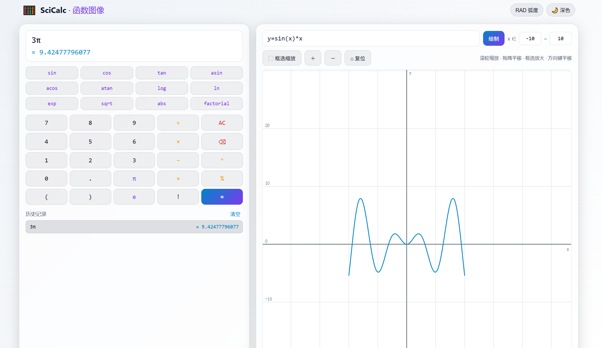

# SciCalc · Web 科学计算器 + 函数图像绘制平台

一个展示型全栈作品项目：左侧科学计算器、右侧函数图像绘制，所有数学计算（含函数采样）都在 **Python 核心引擎** 中完成，前端只负责调用与渲染。


**科学计算器**
- 四则运算 `+ - * /`、括号、幂 `^`、取模 `%`、取负号、阶乘 `!`
- 科学函数 `sin cos tan asin acos atan log ln exp sqrt abs factorial`，常量 `π`、`e`
- 角度 / 弧度切换（默认弧度，DEG 下 `sin(90) = 1`）
- 有限隐式乘法：`2x`、`2(x+1)`、`3π`、`(x+1)(x-1)`、`xπ` 自动识别
- 表达式实时校验（走引擎 `validate`，带错误位置的中文提示）
- 结果 `Decimal` 高精度 + 1e-12 阈值净化（`0.1+0.2 = 0.3`、`sin(π) = 0`）
- 历史记录（localStorage 持久化，上限 200 条，点击回填、可清空）

**函数图像**
- 支持 `y = f(x)` / `f(x) = ...` 前缀，自变量 `x`，默认范围 `[-10, 10]`
- 自适应采样：每像素 ≥1 采样点 + 陡峭/弯曲段二分加密（最多 3 层）+ LOD 上限 20000
- 断点处理：`1/x`、`tan(x)` 等在极点处**强制断线**，绝不画成竖线
- 缩放（滚轮锚点 / 框选 / ＋－按钮）、平移（拖拽 / 方向键）、复位
- 1-2-5 序列自适应刻度网格、坐标轴、悬停显示最近采样点坐标

## 架构

```
前端 UI (React + Vite + Canvas)
  ├─ CalculatorPanel / PlotPanel
  └─ engine.js  ← 统一桥接层（HTTP ⇄ WASM 自动降级）
          │  表达式字符串 + 参数（不含任何计算）
Python 核心引擎 core/（唯一计算来源）
  ├─ tokenizer.py  词法分析（含有限隐式乘法）
  ├─ parser.py     语法分析 → AST（Pratt 递归下降）
  ├─ evaluator.py  安全求值（Decimal 高精度 + 定义域检查）
  ├─ sampler.py    自适应采样 + 断点检测 + LOD
  └─ engine.py     统一入口 evaluate / validate / sample_function
```

**架构铁律**：前端不包含任何数学/采样逻辑，仅允许坐标换算与渲染；`engine.js` 内部对 `evaluate` 与 `sampleFunction` 双通道透明。

## 目录结构

```
sci-calc-plot/
├─ core/            # Python 核心引擎（纯标准库）
├─ api/             # FastAPI Serverless（Vercel）
├─ frontend/        # React + Vite 前端
│  └─ src/
│     ├─ engine.js  # 桥接层（HTTP / Pyodide WASM 降级）
│     ├─ lib/       # 纯函数：坐标换算、历史、键盘映射（含 Vitest 测试）
│     └─ components/
├─ tests/           # pytest 核心引擎测试
├─ conftest.py      # pytest 路径配置
├─ requirements.txt
└─ vercel.json
```

## 运行方式

### 1. 核心引擎（pytest）
```bash
pip install -r requirements.txt
pytest                    # 在项目根目录运行
```

### 2. 前端（Vite）
```bash
cd frontend
npm install
npm run dev              # 开发服务器 http://localhost:5173
```

本地联调（可选，验证 HTTP 通道）：
```bash
# 另开一个终端，启动 FastAPI
uvicorn api.index:app --reload --port 8000
# vite 已把 /api 代理到 localhost:8000
```

> 前端启动时 `predev` 会自动把 `core/*.py` 同步到 `frontend/public/core/`，供 Pyodide（WASM 降级通道）加载。**不启动后端也能用**：HTTP 不可达时 `engine.js` 自动降级到 Pyodide。

### 3. 测试
```bash
pytest                    # 核心引擎
cd frontend && npm test   # 前端纯函数（Vitest）
```

## 数据存储与隐私

- 计算历史记录保存在**浏览器本地 `localStorage`** 中（键 `sci-calc-history`，上限 200 条），**不上传任何服务器**；主题偏好同样存于本地（键 `sci-theme`）。
- 表达式与采样请求只把「表达式字符串 + 参数」发给计算引擎求值，**不存储、不收集**任何用户输入或使用记录。
- 清除浏览器数据 / 站点数据即可彻底删除上述本地记录。


## 部署方案

### 方案 A —— Vercel（推荐，HTTP 通道）
1. 将仓库推送到 GitHub，在 Vercel 导入。
2. Framework Preset 选 **Vite**，Root Directory 填 `frontend`，Build Command `npm run build`，Output `frontend/dist`。
3. 把 `api/` 作为 Python Serverless Function 部署（`vercel.json` 已配置 `/api/* → api/index.py`）。

### 方案 B —— GitHub Pages（WASM 纯静态）
1. `npm run build` 产物 `frontend/dist` 直接部署到 Pages（`vite.config.js` 已设 `base: './'`）。
2. 无后端 → `engine.js` 自动加载 Pyodide（CDN）在浏览器内运行同一套 `core/` 源码。

## 测试报告

| 层 | 工具 | 结果 |
|---|---|---|
| 核心引擎 | pytest | **56 passed** |
| 前端纯函数 | Vitest | **14 passed** |

核心覆盖：嵌套括号、一元负号优先级（`-2^2 = -4`）、右结合幂（`2^3^2 = 512`）、精度（`0.1+0.2 = 0.3`）、除零/负开方/对数越域错误码、`1/x` 与 `tan(x)` 断点不连线、`x^3` 陡峭段自适应加密、空定义域、非法范围。

## 设计取舍与已知问题

- **`%` 取模**：按「取模」语义实现为二元运算符（`10%3 = 1`）；「百分号」后缀（`50% = 0.5`）未实现，需要百分比请用 `/100`。
- **`0^0`**：按常见约定定义为 `1`。
- **隐式乘法**：仅「有限」范围（见上），`x x`、`2 3`、`π e` 视为语法错误。
- **超越函数**：`sin/cos/tan/log/exp` 等用双精度 `math` 计算后转回 `Decimal`；基本算术全程 `Decimal` 高精度。这是「纯标准库、CPython/Pyodide 双兼容」的折中。
- **多曲线对比**：当前为单曲线；多曲线（`y=sin(x), y=cos(x)`）留作扩展。
- **断点空心圆提示**：当前以断线 + 极点剪裁呈现，未绘制空心圆标记（可选优化项）。

## 截图



## 许可证

本项目采用 [MIT License](LICENSE)（Copyright © 2026 卢心艺）。
